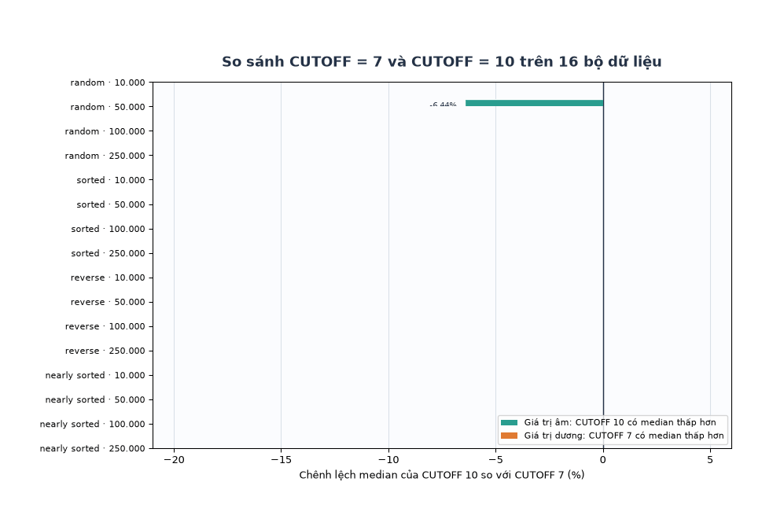
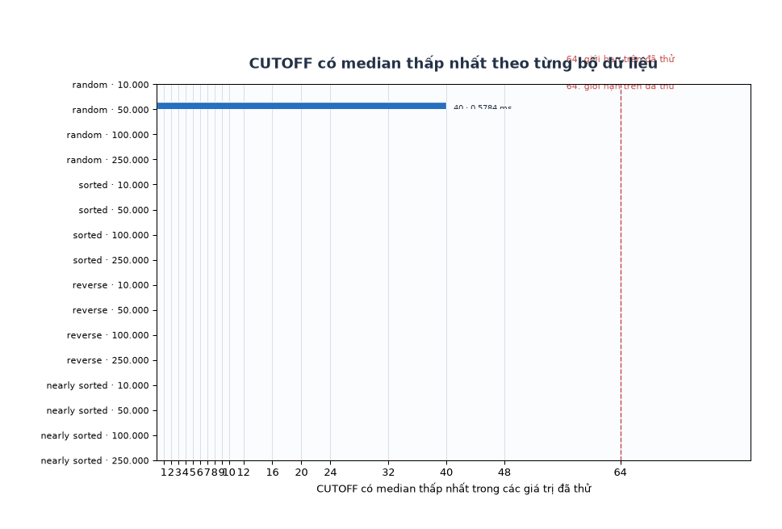
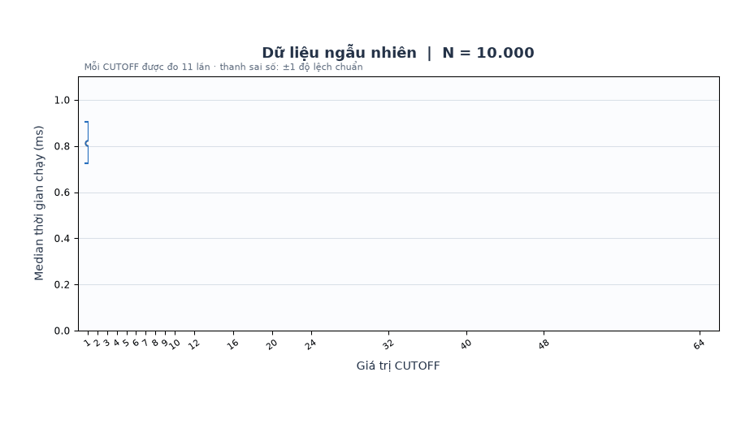
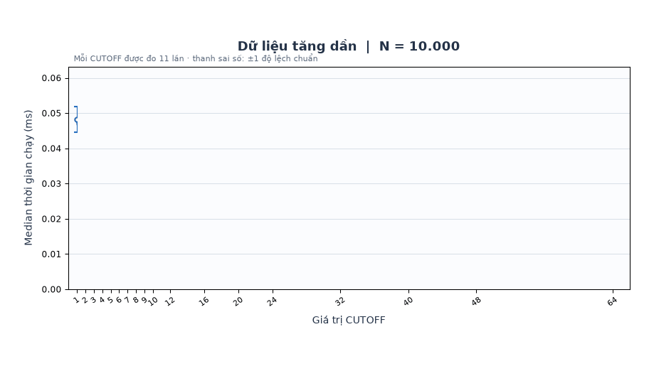
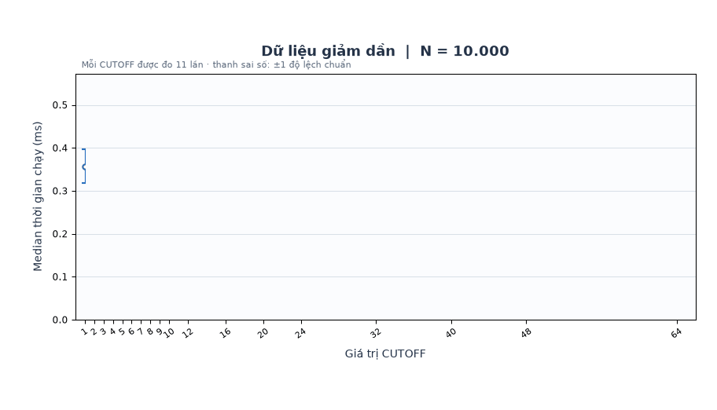
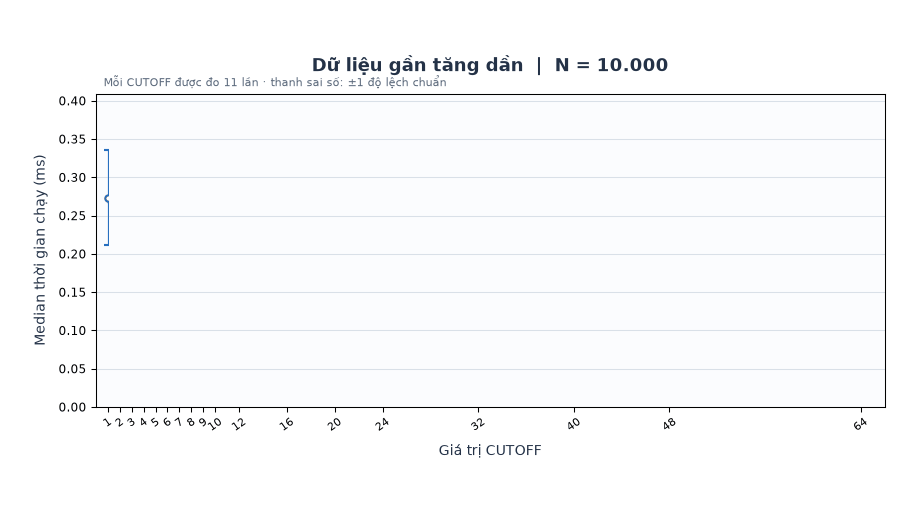

# Thí nghiệm tìm CUTOFF phù hợp cho Top-down Mergesort

Repository: <https://github.com/hoangdinhdat1147/MergeSort-CUTOFF-Experiment>

Dự án khảo sát ảnh hưởng của ngưỡng `CUTOFF` đến thời gian chạy của một cài đặt **Top-down Mergesort**. Khi kích thước đoạn con không vượt quá `CUTOFF`, chương trình sử dụng **Insertion Sort** để sắp xếp đoạn đó; với các đoạn lớn hơn, thuật toán tiếp tục chia đôi và trộn như Mergesort thông thường.

Thí nghiệm tập trung so sánh hai giá trị thường được đề cập là `CUTOFF = 7` và `CUTOFF = 10`, đồng thời khảo sát thêm các giá trị khác để tìm vùng có hiệu năng tốt trên những bộ dữ liệu đã chọn.

## 1. Mục tiêu

- Đo ảnh hưởng của `CUTOFF` đến thời gian chạy của cùng một cài đặt Top-down Mergesort.
- So sánh riêng hiệu năng của `CUTOFF = 7` và `CUTOFF = 10`.
- Khảo sát nhiều giá trị `CUTOFF` trên các kích thước và dạng dữ liệu khác nhau.
- Dùng số liệu đo lặp, median và độ lệch chuẩn để đánh giá kết quả thay vì kết luận từ một lần chạy đơn lẻ.

## 2. Cấu trúc dự án

```text
MergeSort-CUTOFF-Experiment/
│
├── datasets/                         # Các bộ dữ liệu đầu vào
│
├── src/                              # Mã nguồn Java
│   ├── MergeSort.java
│   └── Experiment.java
│
├── scripts/                          # Công cụ sinh dữ liệu và phân tích
│   ├── generate_data.py
│   └── analyze_results.py
│
├── analysis/                         # Bảng thống kê và biểu đồ
│   ├── summary.csv
│   ├── best_cutoff.csv
│   ├── cutoff_7_10_comparison.csv
│   ├── best_cutoff_from_run.csv
│   ├── comparison_cutoff_7_10.png
│   ├── best_cutoff_by_dataset.png
│   └── các biểu đồ riêng theo từng bộ dữ liệu
│
├── results.csv                       # Dữ liệu đo thô
├── run_experiment.bat                # Chạy toàn bộ quy trình trên Windows
├── Bao_cao_thi_nghiem_CUTOFF.docx    # Báo cáo thí nghiệm
└── README.md
```

Một số tệp trong `analysis/` là kết quả bổ sung được lưu kèm báo cáo. Vai trò của từng loại kết quả được giải thích tại [Mục 7](#7-các-tệp-kết-quả).

## 3. Môi trường và yêu cầu

### 3.1. Phần mềm cần có

- **JDK 11 trở lên**: cần có cả `java` và `javac` trong `PATH`.
- **Python 3**.
- **Matplotlib** để tạo biểu đồ.
- Hệ điều hành Windows nếu sử dụng trực tiếp `run_experiment.bat`.

Cài Matplotlib bằng PowerShell:

```powershell
python -m pip install matplotlib
```

### 3.2. Môi trường đã dùng cho lần chạy báo cáo

| Thành phần | Phiên bản / thông tin |
|---|---|
| Hệ điều hành | Windows 11, Version 26H2 (OS Build 26300.9818) |
| PowerShell | Windows PowerShell 5.1 |
| Java | Java 25.0.2 LTS |
| Trình biên dịch | `javac 25.0.2` |
| Python | Python 3.14.7 |
| Matplotlib | 3.11.2 |
| CPU | 11th Gen Intel Core i7-1185G7 @ 3.00 GHz |
| RAM | 32 GB (khả dụng 31,7 GB) |


## 4. Tải dự án và chạy thí nghiệm

### 4.1. Tải dự án từ GitHub

Mở PowerShell tại thư mục muốn lưu dự án và chạy:

```powershell
git clone https://github.com/hoangdinhdat1147/MergeSort-CUTOFF-Experiment.git
cd MergeSort-CUTOFF-Experiment
```

### 4.2. Chạy nhanh trên Windows

Tại thư mục gốc của dự án, chạy:

```powershell
.\run_experiment.bat
```

Tệp batch tự động thực hiện các công việc sau:

1. Sinh lại các bộ dữ liệu trong `datasets/`.
2. Tạo thư mục `out/` nếu thư mục chưa tồn tại.
3. Biên dịch hai tệp Java.
4. Chạy chương trình benchmark và ghi kết quả vào `results.csv`.
5. Phân tích kết quả, tạo các bảng thống kê và biểu đồ trong `analysis/`.

Nếu chương trình báo thiếu Matplotlib, cài thư viện theo Mục 3.1 rồi chạy lại.

### 4.3. Chạy từng bước thủ công

Các lệnh dưới đây dành cho Windows PowerShell, thực hiện lần lượt tại thư mục gốc của dự án.

**Bước 1 – Sinh dữ liệu:**

```powershell
python scripts\generate_data.py
```

**Bước 2 – Tạo thư mục chứa tệp đã biên dịch:**

```powershell
New-Item -ItemType Directory -Force -Path out | Out-Null
```

**Bước 3 – Biên dịch mã nguồn Java:**

```powershell
javac -encoding UTF-8 -d out src\MergeSort.java src\Experiment.java
```

**Bước 4 – Chạy thí nghiệm:**

```powershell
java -cp out Experiment datasets results.csv
```

**Bước 5 – Tổng hợp kết quả và vẽ biểu đồ:**

```powershell
python scripts\analyze_results.py
```

Sau khi hoàn thành, kiểm tra `results.csv` và thư mục `analysis/`.

## 5. Thiết kế thí nghiệm

### 5.1. Các giá trị CUTOFF

Thí nghiệm khảo sát 18 giá trị:

```text
1, 2, 3, 4, 5, 6, 7, 8, 9, 10, 12, 16, 20, 24, 32, 40, 48, 64
```

Trong đó, `7` và `10` là hai giá trị được so sánh riêng theo yêu cầu của bài toán.

### 5.2. Kích thước và dạng dữ liệu

Bốn kích thước mảng được sử dụng:

- 10.000 phần tử.
- 50.000 phần tử.
- 100.000 phần tử.
- 250.000 phần tử.

Với mỗi kích thước, chương trình tạo bốn dạng dữ liệu:

| Dạng dữ liệu | Mô tả |
|---|---|
| `random` | Các số nguyên được sinh ngẫu nhiên. |
| `sorted` | Dữ liệu được sắp xếp tăng dần. |
| `reverse` | Dữ liệu được sắp xếp giảm dần. |
| `nearly_sorted` | Ban đầu tăng dần, sau đó hoán đổi ngẫu nhiên khoảng 1% số cặp vị trí. |

Dữ liệu được sinh bằng seed cơ sở cố định `20261117`; bộ sinh sử dụng seed kết hợp với kích thước mảng để có thể tái tạo các bộ dữ liệu.

Tổng cộng có:

```text
4 kích thước × 4 dạng dữ liệu = 16 bộ dữ liệu
```

### 5.3. Số lượt chạy và thứ tự đo

- Chương trình thực hiện **3 lượt warm-up** trước giai đoạn đo chính thức.
- Mỗi tổ hợp bộ dữ liệu và giá trị `CUTOFF` được đo **11 lần**.
- Thứ tự các giá trị `CUTOFF` được xáo trộn trong giai đoạn warm-up và ở mỗi lượt đo chính thức để giảm ảnh hưởng của việc luôn chạy một giá trị trước hoặc sau.
- Tổng số phép đo chính thức:

```text
16 bộ dữ liệu × 18 giá trị CUTOFF × 11 lần = 3.168 phép đo
```

Các lượt warm-up không được tính vào 3.168 phép đo chính thức.

### 5.4. Cách đo thời gian

- Mỗi lượt chạy tạo một bản sao của mảng đầu vào trước khi bắt đầu đo.
- Thời gian sao chép mảng không được tính vào thời gian sắp xếp.
- Chỉ đo thời gian thực thi `MergeSort.sort` bằng `System.nanoTime()`.
- Không tính thời gian đọc tệp, sinh dữ liệu, ghi CSV hoặc kiểm tra kết quả vào khoảng thời gian của thuật toán.
- Sau khi sắp xếp, chương trình kiểm tra mảng đầu ra đã được sắp xếp tăng dần. Các lượt chạy có kết quả không hợp lệ không được xem là kết quả đúng.

## 6. Kết quả lần chạy ngày 17/11/2026

### 6.1. So sánh CUTOFF 7 và CUTOFF 10

Dựa trên median của 11 lần đo cho từng bộ dữ liệu:

- `CUTOFF = 10` có median thấp hơn trong **10/16 bộ dữ liệu**.
- `CUTOFF = 7` có median thấp hơn trong **6/16 bộ dữ liệu**.
- Mức chênh lệch thay đổi theo kích thước và dạng dữ liệu; có trường hợp hai median rất gần nhau.

Vì vậy, kết quả này không chứng minh rằng `CUTOFF = 10` luôn nhanh hơn `CUTOFF = 7`. Cần xem xét cả độ lớn chênh lệch và mức dao động giữa các lần đo.

### 6.2. Khảo sát toàn bộ miền CUTOFF

Khi so sánh 18 giá trị đã thử, `CUTOFF = 64` có median thấp nhất trong **7/16 bộ dữ liệu**. Tuy nhiên, 64 cũng là giá trị lớn nhất trong miền khảo sát. Do đó, kết quả chỉ cho biết 64 là giá trị tốt nhất trong các giá trị đã thử ở những bộ dữ liệu tương ứng; chưa thể kết luận đây là CUTOFF tối ưu toàn cục.

Các kết quả tốt nhất của từng bộ dữ liệu được lưu trong `analysis/best_cutoff.csv` và `analysis/best_cutoff_from_run.csv`.


### 6.3. So sánh CUTOFF 7 và CUTOFF 10

Biểu đồ thể hiện median thời gian chạy của hai giá trị CUTOFF trên 16 bộ dữ liệu.



### 6.4. CUTOFF có median thấp nhất

Biểu đồ cho biết giá trị CUTOFF có median thấp nhất trong 18 giá trị được thử ở từng bộ dữ liệu.



### 6.5. Kết quả theo dạng dữ liệu

**Dữ liệu ngẫu nhiên (Random)**



**Dữ liệu tăng dần (Sorted)**



**Dữ liệu giảm dần (Reverse)**



**Dữ liệu gần tăng dần (Nearly sorted)**



## 7. Các tệp kết quả

| Tệp | Nội dung | Cách tạo |
|---|---|---|
| `results.csv` | Dữ liệu thô; mỗi dòng là một lần đo, gồm bộ dữ liệu, kích thước, CUTOFF, số lần lặp, thời gian và trạng thái kiểm tra. | `Experiment.java` |
| `analysis/summary.csv` | Số lần đo, median, mean, độ lệch chuẩn, min và max theo từng bộ dữ liệu và CUTOFF. | `scripts/analyze_results.py` |
| `analysis/best_cutoff.csv` | Giá trị có median nhỏ nhất trong miền CUTOFF đã thử cho từng bộ dữ liệu. | `scripts/analyze_results.py` |
| `analysis/*.png` | Biểu đồ median thời gian theo CUTOFF cho từng bộ dữ liệu. | `scripts/analyze_results.py` |
| `analysis/cutoff_7_10_comparison.csv` | Bảng so sánh median và độ lệch chuẩn của CUTOFF 7 và 10. | Tệp tổng hợp bổ sung cho báo cáo |
| `analysis/best_cutoff_from_run.csv` | Bảng CUTOFF tốt nhất quan sát được trong lần chạy được báo cáo. | Tệp tổng hợp bổ sung cho báo cáo |
| `analysis/comparison_cutoff_7_10.png` | Biểu đồ tổng hợp so sánh CUTOFF 7 và 10. | Tệp biểu đồ bổ sung cho báo cáo |
| `analysis/best_cutoff_by_dataset.png` | Biểu đồ tổng hợp CUTOFF tốt nhất theo bộ dữ liệu. | Tệp biểu đồ bổ sung cho báo cáo |

**Lưu ý:** `scripts/analyze_results.py` tự động tạo `summary.csv`, `best_cutoff.csv` và các biểu đồ riêng theo bộ dữ liệu. Các bảng và biểu đồ tổng hợp bổ sung nêu trên được lưu kèm repository; chúng không được script phân tích hiện tại tự động tạo lại. Nếu thay đổi dữ liệu hoặc chạy benchmark mới, cần cập nhật các tệp tổng hợp này trước khi dùng chúng để mô tả lần chạy mới.

Báo cáo chi tiết: [`Bao_cao_thi_nghiem_CUTOFF.docx`](Bao_cao_thi_nghiem_CUTOFF.docx).

## 8. Cách phân tích và diễn giải

- Dùng **median** làm số đo trung tâm vì median ít bị kéo lệch bởi một vài lần chạy bất thường hơn mean.
- Xem thêm **mean** và **độ lệch chuẩn** để hiểu mức dao động của thời gian chạy.
- Không tự ý xóa các lần chạy chậm bất thường khỏi `results.csv`. Nếu cần, có thể thực hiện phân tích độ nhạy riêng, nhưng phải giữ nguyên dữ liệu gốc và trình bày rõ cách phân tích.
- Khi hai median gần nhau, nên mô tả kết quả là sát nhau; không nên tuyên bố một phương án thắng rõ rệt chỉ dựa trên chênh lệch rất nhỏ.
- Kết quả đo benchmark đơn lẻ không tự chứng minh khác biệt có ý nghĩa thống kê. README và báo cáo này không đưa ra kết luận kiểm định thống kê.
- Muốn khảo sát vùng tối ưu đầy đủ hơn, cần mở rộng miền CUTOFF vượt quá 64 và chạy lại trên nhiều seed dữ liệu.

## 9. Giới hạn và lưu ý khi tái lập

Kết quả chỉ áp dụng cho cài đặt Mergesort, bộ dữ liệu, cấu hình CUTOFF, máy tính, JDK, hệ điều hành và điều kiện chạy đã dùng trong thí nghiệm. Thời gian benchmark có thể thay đổi do tải CPU, các tiến trình chạy nền, cơ chế JIT của JVM và khác biệt phần cứng.

Để các lần chạy có thể so sánh tốt hơn:

1. Dùng cùng phiên bản mã nguồn và cùng bộ dữ liệu.
2. Đóng các ứng dụng tiêu thụ CPU lớn trong lúc benchmark.
3. Tránh chạy nhiều chương trình benchmark đồng thời.
4. Nếu dùng laptop, nên cắm sạc và giữ cùng chế độ nguồn giữa các lần chạy.
5. Ghi lại CPU, dung lượng RAM, hệ điều hành và phiên bản JDK khi thu thập kết quả.

Dữ liệu sinh bằng seed cố định giúp tái tạo đầu vào, nhưng không đảm bảo thời gian chạy sẽ giống hệt nhau giữa các lần thực nghiệm hoặc trên các máy khác nhau.

---

**Trạng thái báo cáo:** kết quả lần chạy ngày 17/11/2026. Máy thực nghiệm sử dụng Intel Core i7-1185G7, RAM 32 GB, Windows 11 và Java 25.0.2 LTS.
