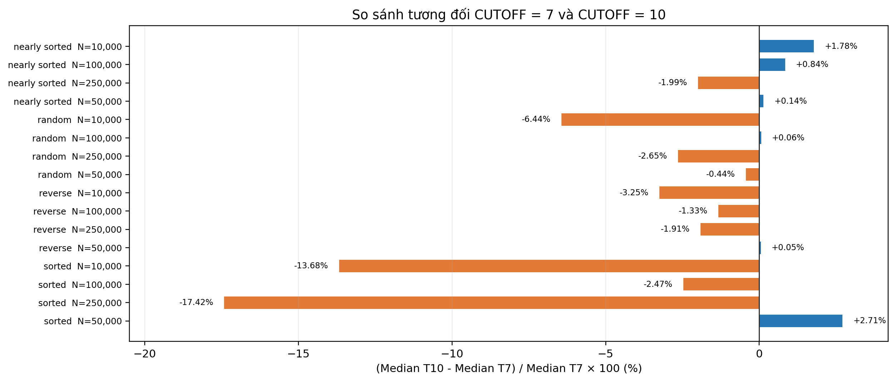

# Thí nghiệm tìm CUTOFF phù hợp cho Top-down Mergesort

[](https://github.com/hoangdinhdat1147/MergeSort-CUTOFF-Experiment/actions/workflows/ci.yml)


[](https://hoangdinhdat1147.github.io/MergeSort-CUTOFF-Experiment/)

Dự án khảo sát ảnh hưởng của ngưỡng `CUTOFF` đến thời gian chạy của một cài đặt **Top-down Mergesort**. Khi kích thước đoạn con không vượt quá `CUTOFF`, chương trình sử dụng **Insertion Sort** để sắp xếp đoạn đó; với các đoạn lớn hơn, thuật toán tiếp tục chia đôi và trộn như Mergesort thông thường.

Thí nghiệm tập trung so sánh hai giá trị thường được đề cập là `CUTOFF = 7` và `CUTOFF = 10`, đồng thời khảo sát thêm các giá trị khác để tìm vùng có hiệu năng tốt trên những bộ dữ liệu đã chọn.

**[Mở dashboard tương tác](https://hoangdinhdat1147.github.io/MergeSort-CUTOFF-Experiment/)** · [Báo cáo thí nghiệm (.docx)](report/Bao_cao_thi_nghiem_CUTOFF.docx) · [Dữ liệu đo thô (`results.csv`)](results.csv)



## Mục lục

- [Tóm tắt kết quả](#tóm-tắt-kết-quả)
- [1. Mục đích và mục tiêu nghiên cứu](#1-mục-đích-và-mục-tiêu-nghiên-cứu)
- [2. Cài đặt thuật toán](#2-cài-đặt-thuật-toán)
- [3. Cấu trúc dự án](#3-cấu-trúc-dự-án)
- [4. Môi trường và yêu cầu](#4-môi-trường-và-yêu-cầu)
- [5. Tải dự án và chạy thí nghiệm](#5-tải-dự-án-và-chạy-thí-nghiệm)
- [6. Thiết kế thí nghiệm](#6-thiết-kế-thí-nghiệm)
- [7. Kết quả lần chạy ngày 17/11/2026](#7-kết-quả-lần-chạy-ngày-17112026)
- [8. Các tệp kết quả](#8-các-tệp-kết-quả)
- [9. Cách phân tích và diễn giải](#9-cách-phân-tích-và-diễn-giải)
- [10. Giới hạn và lưu ý khi tái lập](#10-giới-hạn-và-lưu-ý-khi-tái-lập)
- [11. Tài liệu tham khảo](#11-tài-liệu-tham-khảo)

## Tóm tắt kết quả

Dựa trên median của 11 lần đo cho mỗi cấu hình (16 bộ dữ liệu × 18 giá trị CUTOFF = 3.168 phép đo chính thức):

- **CUTOFF 7 so với 10:** `CUTOFF = 10` có median thấp hơn ở **10/16** bộ dữ liệu, `CUTOFF = 7` thấp hơn ở **6/16** bộ. Có 5/16 bộ chênh lệch dưới 1%, nên không thể kết luận một giá trị luôn nhanh hơn.
- **Toàn bộ miền 1–64:** `CUTOFF = 64` có median thấp nhất ở **7/16** bộ, nhưng 64 là giá trị lớn nhất đã thử nên chưa thể xem là tối ưu toàn cục.
- **Phạm vi kết luận:** chỉ áp dụng cho cài đặt, bộ dữ liệu và máy đo trong thí nghiệm này (xem [Mục 10](#10-giới-hạn-và-lưu-ý-khi-tái-lập)).

## 1. Mục đích và mục tiêu nghiên cứu

### 1.1. Mục đích nghiên cứu

Nghiên cứu này nhằm đánh giá bằng thực nghiệm ảnh hưởng của ngưỡng CUTOFF đến hiệu năng của thuật toán Top-down Mergesort khi kết hợp với Insertion Sort để xử lý các đoạn mảng nhỏ.

Việc lựa chọn CUTOFF tạo ra sự đánh đổi giữa chi phí chia đệ quy, trộn các đoạn mảng và chi phí sắp xếp trực tiếp bằng Insertion Sort. Khi thay đổi ngưỡng này, hiệu năng của thuật toán có thể thay đổi theo kích thước và đặc điểm dữ liệu đầu vào. Do đó, không thể chỉ dựa vào phân tích lý thuyết để xác định một giá trị phù hợp mà cần tiến hành đo đạc trên chương trình thực tế.

Thông qua việc sử dụng cài đặt Mergesort tự xây dựng theo nội dung bài giảng, nghiên cứu hướng tới việc xác định giá trị hoặc vùng giá trị CUTOFF cho hiệu năng tốt trong phạm vi cấu hình phần cứng và các điều kiện thực nghiệm đã khảo sát.

### 1.2. Mục tiêu cụ thể

- Đánh giá ảnh hưởng của việc thay đổi CUTOFF đến thời gian thực thi của Top-down Mergesort kết hợp với Insertion Sort.
- Kiểm chứng và so sánh hiệu năng của hai giá trị CUTOFF = 7 và CUTOFF = 10 được đề cập trong các phiên bản giáo trình.
- Khảo sát 18 giá trị CUTOFF trên nhiều kích thước và dạng dữ liệu đầu vào nhằm tìm ra giá trị có hiệu năng tốt trong miền đã thử nghiệm.
- Phân tích ảnh hưởng của kích thước và đặc điểm dữ liệu đầu vào đến hiệu quả của từng giá trị CUTOFF.
- Tổng hợp và đánh giá kết quả dựa trên các lần đo lặp, sử dụng median và độ lệch chuẩn, kết hợp bảng thống kê và biểu đồ.

### 1.3. Câu hỏi nghiên cứu

Nghiên cứu tập trung trả lời ba câu hỏi:

1. CUTOFF = 7 và CUTOFF = 10 có tạo ra sự khác biệt về thời gian thực thi hay không? Mức chênh lệch có giống nhau trên các bộ dữ liệu khác nhau không?
2. Kích thước và đặc điểm dữ liệu đầu vào ảnh hưởng như thế nào đến hiệu năng khi thay đổi CUTOFF?
3. Trong các giá trị đã khảo sát, giá trị nào cho thời gian thực thi tốt nhất đối với từng bộ dữ liệu? Có thể xác định một vùng CUTOFF phù hợp tương đối ổn định hay không?

**Phạm vi kết luận:** Kết quả chỉ có giá trị đối với cài đặt Mergesort, cấu hình phần cứng và các điều kiện thực nghiệm cụ thể của nghiên cứu; không khẳng định tồn tại một giá trị CUTOFF tối ưu cho mọi hệ thống.

## 2. Cài đặt thuật toán

Mã nguồn nằm trong [`src/MergeSort.java`](src/MergeSort.java), theo cấu trúc Algorithm 2.4 (Top-down Mergesort) của Sedgewick & Wayne và có hai cải tiến:

1. **Cutoff sang Insertion Sort:** đoạn con có không quá `cutoff` phần tử được sắp xếp bằng Insertion Sort thay vì tiếp tục chia đôi. Đây là tham số được khảo sát.
2. **Bỏ qua merge khi đã đúng thứ tự:** sau khi sắp xếp hai nửa, nếu `a[mid] <= a[mid + 1]` thì không gọi `merge()` (Exercise 2.2.8 trong sách).

Mảng phụ `aux` được cấp phát một lần và dùng chung cho mọi lần merge.

> **Lưu ý khi đọc kết quả:** nhờ cải tiến thứ hai, với dữ liệu *tăng dần* không có lời gọi `merge()` nào được thực hiện, còn với dữ liệu *gần tăng dần* một phần các lần merge cũng bị bỏ qua. Vì vậy kết quả trên hai dạng này phản ánh cách cài đặt cụ thể này và có thể khác với một cài đặt Mergesort không có bước kiểm tra đó.

Toàn bộ số liệu trong repository được đo bằng đúng logic trong `MergeSort.java`. Nếu thay đổi thuật toán, các kết quả đã công bố sẽ không còn tương ứng với mã nguồn và cần chạy lại thí nghiệm.

## 3. Cấu trúc dự án

```text
MergeSort-CUTOFF-Experiment/
│
├── src/                              # Mã nguồn Java
│   ├── MergeSort.java                #   thuật toán
│   └── Experiment.java               #   chương trình benchmark
│
├── test/
│   └── MergeSortTest.java            # Kiểm thử tính đúng đắn (không cần thư viện ngoài)
│
├── datasets/                         # 16 bộ dữ liệu đầu vào
│   └── SHA256SUMS                    #   mã băm để kiểm tra dữ liệu không bị sửa
│
├── scripts/                          # Sinh dữ liệu, phân tích, vẽ biểu đồ
│   ├── generate_data.py
│   ├── analyze_results.py
│   └── make_animated_charts.py
│
├── analysis/                         # Bảng thống kê và biểu đồ (xem analysis/README.md)
│   ├── summary.csv
│   ├── best_cutoff.csv
│   ├── cutoff_7_10_comparison.csv
│   ├── best_cutoff_from_run.csv
│   ├── comparison_cutoff_7_10.png
│   ├── best_cutoff_by_dataset.png
│   ├── <bo_du_lieu>.txt.png          #   biểu đồ riêng theo từng bộ dữ liệu
│   └── animated/                     #   6 biểu đồ GIF
│
├── docs/                             # Dashboard GitHub Pages
│   ├── index.html
│   └── data/                         #   bản sao 3 CSV dùng cho dashboard
│
├── report/
│   └── Bao_cao_thi_nghiem_CUTOFF.docx  # Báo cáo thí nghiệm
│
├── .github/workflows/ci.yml          # Kiểm tra tự động trên GitHub Actions
├── results.csv                       # Dữ liệu đo thô
├── run_experiment.bat                # Chạy toàn bộ quy trình trên Windows
├── run_experiment.sh                 # Chạy toàn bộ quy trình trên Linux/macOS
├── requirements.txt                  # Thư viện Python cho phần phân tích
└── README.md
```

## 4. Môi trường và yêu cầu

### 4.1. Phần mềm cần có

- **JDK 11 trở lên**: cần có cả `java` và `javac` trong `PATH`.
- **Python 3** (sinh dữ liệu và phân tích).
- **Matplotlib** và **Pillow** để vẽ biểu đồ (khai báo trong `requirements.txt`). Việc sinh dữ liệu và chạy benchmark không cần thư viện ngoài.
- Windows dùng `run_experiment.bat`; Linux/macOS dùng `run_experiment.sh`.

Cài thư viện Python:

```bash
python -m pip install -r requirements.txt
```

### 4.2. Môi trường đã dùng cho lần chạy báo cáo

| Thành phần | Phiên bản / thông tin |
|---|---|
| Hệ điều hành | Windows 11, Version 26H2 (OS Build 26300.9818) |
| PowerShell | Windows PowerShell 5.1 |
| Java | Java 25.0.2 LTS |
| Trình biên dịch | `javac 25.0.2` |
| Python | Python 3.14.7 |
| Matplotlib | 3.11.2 |
| CPU | 11th Gen Intel Core i7-1185G7 @ 3.00 GHz |
| RAM | 32 GB (khả dụng 31,7 GB) |

## 5. Tải dự án và chạy thí nghiệm

### 5.1. Tải dự án từ GitHub

```bash
git clone https://github.com/hoangdinhdat1147/MergeSort-CUTOFF-Experiment.git
cd MergeSort-CUTOFF-Experiment
python -m pip install -r requirements.txt
```

### 5.2. Chạy nhanh toàn bộ quy trình

| Hệ điều hành | Lệnh (tại thư mục gốc dự án) |
|---|---|
| Windows (PowerShell) | `.\run_experiment.bat` |
| Linux / macOS | `./run_experiment.sh` |

Script thực hiện lần lượt:

1. Sinh lại các bộ dữ liệu trong `datasets/` và kiểm tra khớp `datasets/SHA256SUMS`.
2. Biên dịch mã nguồn Java (kể cả phần kiểm thử) vào thư mục `out/`.
3. Chạy kiểm thử `MergeSortTest`.
4. Chạy benchmark đầy đủ (3 warm-up, 11 lần đo) và ghi `results.csv`. **Nếu đã có `results.csv`, bản cũ được sao lưu trước khi bị ghi đè** (`results_old_*.csv`, đã được `.gitignore` bỏ qua).
5. Tổng hợp kết quả, vẽ biểu đồ trong `analysis/` và đồng bộ CSV sang `docs/data/` cho dashboard.

**Chạy thử nhanh** (0 warm-up, 1 lần đo, mất vài giây, không ghi đè `results.csv` hay `analysis/`; kết quả nằm trong `out/quick/`):

```bash
./run_experiment.sh --quick        # Windows: .\run_experiment.bat --quick
```

Nếu chương trình báo thiếu Matplotlib, cài thư viện theo Mục 4.1 rồi chạy lại.

### 5.3. Chạy từng bước thủ công

Các lệnh dưới đây chạy được trên cả PowerShell và bash, thực hiện lần lượt tại thư mục gốc của dự án.

```bash
# Bước 1 – Sinh dữ liệu và kiểm tra tính toàn vẹn
python scripts/generate_data.py
python scripts/generate_data.py --verify

# Bước 2 – Biên dịch (tạo thư mục out trước: bash dùng `mkdir -p out`,
#          PowerShell dùng `New-Item -ItemType Directory -Force -Path out | Out-Null`)
javac -encoding UTF-8 -d out src/MergeSort.java src/Experiment.java test/MergeSortTest.java

# Bước 3 – Kiểm thử
java -cp out MergeSortTest

# Bước 4 – Chạy thí nghiệm (mặc định: datasets -> results.csv, 3 warm-up, 11 lần đo)
java -cp out Experiment datasets results.csv

# Bước 5 – Tổng hợp kết quả và vẽ biểu đồ (thêm --sync-docs để cập nhật dashboard)
python scripts/analyze_results.py --sync-docs
```

`Experiment` nhận thêm tùy chọn `--warmups N` và `--repeats N`; xem `java -cp out Experiment --help`. Giá trị mặc định chính là cấu hình đã dùng cho kết quả trong báo cáo.

Biểu đồ GIF được sinh riêng (tùy chọn): `python scripts/make_animated_charts.py`.

### 5.4. Kiểm thử và kiểm tra tự động

- `test/MergeSortTest.java` so sánh `MergeSort.sort` với `Arrays.sort` trên mảng rỗng, mảng 1–2 phần tử, dữ liệu ngẫu nhiên, nhiều giá trị trùng, giá trị biên `int`, dữ liệu tăng/giảm/gần tăng dần và các bộ dữ liệu thật trong `datasets/`. Mảng nhỏ và mảng ngẫu nhiên được thử với mọi CUTOFF từ 1 đến 70 cùng vài giá trị lớn hơn; dữ liệu thật được thử với đúng 18 CUTOFF của thí nghiệm.
- Workflow [`ci.yml`](.github/workflows/ci.yml) chạy trên GitHub Actions (JDK 11, 17 và 21) mỗi lần push/pull request: biên dịch, chạy kiểm thử, kiểm tra mã băm dữ liệu, chạy thử benchmark và phân tích, đồng thời xác nhận rằng các bảng trong `analysis/` đúng là kết quả tính lại từ `results.csv` và `docs/data/` đồng bộ với `analysis/`.

## 6. Thiết kế thí nghiệm

### 6.1. Các giá trị CUTOFF

Thí nghiệm khảo sát 18 giá trị:

```text
1, 2, 3, 4, 5, 6, 7, 8, 9, 10, 12, 16, 20, 24, 32, 40, 48, 64
```

Trong đó, `7` và `10` là hai giá trị được so sánh riêng theo yêu cầu của bài toán.

### 6.2. Kích thước và dạng dữ liệu

Bốn kích thước mảng được sử dụng:

- 10.000 phần tử.
- 50.000 phần tử.
- 100.000 phần tử.
- 250.000 phần tử.

Với mỗi kích thước, chương trình tạo bốn dạng dữ liệu:

| Dạng dữ liệu | Mô tả |
|---|---|
| `random` | Các số nguyên được sinh ngẫu nhiên. |
| `sorted` | Dữ liệu được sắp xếp tăng dần. |
| `reverse` | Dữ liệu được sắp xếp giảm dần. |
| `nearly_sorted` | Ban đầu tăng dần, sau đó hoán đổi ngẫu nhiên khoảng 1% số cặp vị trí. |

Dữ liệu được sinh bằng seed cơ sở cố định `20261117`; bộ sinh sử dụng seed kết hợp với kích thước mảng để có thể tái tạo các bộ dữ liệu. Các tệp trong `datasets/` được sinh lại giống hệt từng byte và có mã băm SHA-256 trong `datasets/SHA256SUMS`.

Tổng cộng có:

```text
4 kích thước × 4 dạng dữ liệu = 16 bộ dữ liệu
```

### 6.3. Số lượt chạy và thứ tự đo

- Chương trình thực hiện **3 lượt warm-up** trước giai đoạn đo chính thức.
- Mỗi tổ hợp bộ dữ liệu và giá trị `CUTOFF` được đo **11 lần**.
- Thứ tự các giá trị `CUTOFF` được xáo trộn (có seed) trong giai đoạn warm-up và ở mỗi lượt đo chính thức để giảm ảnh hưởng của việc luôn chạy một giá trị trước hoặc sau.
- Tổng số phép đo chính thức:

```text
16 bộ dữ liệu × 18 giá trị CUTOFF × 11 lần = 3.168 phép đo
```

Các lượt warm-up không được tính vào 3.168 phép đo chính thức.

### 6.4. Cách đo thời gian

- Mỗi lượt chạy tạo một bản sao của mảng đầu vào trước khi bắt đầu đo.
- Thời gian sao chép mảng không được tính vào thời gian sắp xếp.
- Chỉ đo thời gian thực thi `MergeSort.sort` bằng `System.nanoTime()`.
- Không tính thời gian đọc tệp, sinh dữ liệu, ghi CSV hoặc kiểm tra kết quả vào khoảng thời gian của thuật toán.
- Sau khi sắp xếp, chương trình đối chiếu mảng đầu ra với kết quả của `Arrays.sort`. Nếu có kết quả sai, chương trình dừng với lỗi thay vì ghi số đo.

## 7. Kết quả lần chạy ngày 17/11/2026

Các bảng dưới đây được lấy từ `analysis/cutoff_7_10_comparison.csv` và `analysis/best_cutoff_from_run.csv`; hai tệp này (và `analysis/summary.csv`) đã được kiểm tra là tính lại được chính xác từ `results.csv`.

### 7.1. So sánh CUTOFF 7 và CUTOFF 10

Dựa trên median của 11 lần đo cho từng bộ dữ liệu; Δ = (T10 − T7) / T7 × 100%. Δ âm nghĩa là CUTOFF 10 có median thấp hơn.

| Dạng dữ liệu | N | Median CUTOFF 7 (ms) | Median CUTOFF 10 (ms) | Δ | Median thấp hơn |
|---|---:|---:|---:|---:|:---:|
| Ngẫu nhiên | 10.000 | 0,6557 | 0,6135 | -6,44% | 10 |
| Ngẫu nhiên | 50.000 | 3,7657 | 3,7490 | -0,44% | 10 |
| Ngẫu nhiên | 100.000 | 7,9651 | 7,9695 | +0,06% | 7 |
| Ngẫu nhiên | 250.000 | 22,1386 | 21,5516 | -2,65% | 10 |
| Tăng dần | 10.000 | 0,0234 | 0,0202 | -13,68% | 10 |
| Tăng dần | 50.000 | 0,0958 | 0,0984 | +2,71% | 7 |
| Tăng dần | 100.000 | 0,2149 | 0,2096 | -2,47% | 10 |
| Tăng dần | 250.000 | 0,5694 | 0,4702 | -17,42% | 10 |
| Giảm dần | 10.000 | 0,2553 | 0,2470 | -3,25% | 10 |
| Giảm dần | 50.000 | 1,1147 | 1,1153 | +0,05% | 7 |
| Giảm dần | 100.000 | 2,3715 | 2,3400 | -1,33% | 10 |
| Giảm dần | 250.000 | 6,4574 | 6,3343 | -1,91% | 10 |
| Gần tăng dần | 10.000 | 0,1518 | 0,1545 | +1,78% | 7 |
| Gần tăng dần | 50.000 | 0,8134 | 0,8145 | +0,14% | 7 |
| Gần tăng dần | 100.000 | 1,8126 | 1,8279 | +0,84% | 7 |
| Gần tăng dần | 250.000 | 5,0018 | 4,9023 | -1,99% | 10 |

- `CUTOFF = 10` có median thấp hơn trong **10/16 bộ dữ liệu**.
- `CUTOFF = 7` có median thấp hơn trong **6/16 bộ dữ liệu**.
- Mức chênh lệch thay đổi theo kích thước và dạng dữ liệu; có trường hợp hai median rất gần nhau (chênh lệch từ 0,05% đến 0,14%).

Vì vậy, kết quả này không chứng minh rằng `CUTOFF = 10` luôn nhanh hơn `CUTOFF = 7`. Cần xem xét cả độ lớn chênh lệch và mức dao động giữa các lần đo (độ lệch chuẩn có trong `analysis/cutoff_7_10_comparison.csv`).

### 7.2. Khảo sát toàn bộ miền CUTOFF

CUTOFF có median thấp nhất trong 18 giá trị đã thử, theo từng bộ dữ liệu:

| Dạng dữ liệu | N = 10.000 | N = 50.000 | N = 100.000 | N = 250.000 |
|---|:---:|:---:|:---:|:---:|
| Ngẫu nhiên | 48 | 64 | 40 | 48 |
| Tăng dần | 64 | 64 | 40 | 64 |
| Giảm dần | 12 | 8 | 10 | 9 |
| Gần tăng dần | 48 | 64 | 64 | 64 |

`CUTOFF = 64` có median thấp nhất trong **7/16 bộ dữ liệu**. Tuy nhiên, 64 cũng là giá trị lớn nhất trong miền khảo sát. Do đó, kết quả chỉ cho biết 64 là giá trị tốt nhất trong các giá trị đã thử ở những bộ dữ liệu tương ứng; chưa thể kết luận đây là CUTOFF tối ưu toàn cục.

Mô tả theo bảng: ở dữ liệu giảm dần, giá trị tốt nhất nằm trong khoảng 8–12; ở ba dạng còn lại, giá trị tốt nhất nằm trong khoảng 40–64. Đây chỉ là mô tả số liệu của một lần chạy trên một máy, không phải kết luận thống kê.

Giá trị median và độ lệch chuẩn đầy đủ của từng cấu hình có trong `analysis/summary.csv`; giá trị tốt nhất của từng bộ dữ liệu trong `analysis/best_cutoff.csv` và `analysis/best_cutoff_from_run.csv`.

### 7.3. Dashboard biểu đồ tương tác

Các biểu đồ tương tác được đặt trong dashboard riêng để có thể chọn dạng dữ liệu, thay đổi kích thước mảng và phát lần lượt các trạng thái. Dashboard sử dụng các bảng CSV được sao chép từ `analysis/` sang `docs/data/`; không chạy lại thuật toán và không tạo thêm số đo.

**[MỞ DASHBOARD – XEM BIỂU ĐỒ TƯƠNG TÁC](https://hoangdinhdat1147.github.io/MergeSort-CUTOFF-Experiment/)**

Dashboard gồm ba phần chính:

- Median thời gian chạy theo CUTOFF, có thể lọc theo dạng dữ liệu, chọn kích thước mảng và phát/tạm dừng chuyển động. Thanh sai số biểu thị ±1 độ lệch chuẩn.
- So sánh median của CUTOFF 7 và CUTOFF 10 trên 16 bộ dữ liệu.
- Bản đồ nhiệt thể hiện CUTOFF có median thấp nhất trong 18 giá trị đã thử.

Chuyển động chỉ thay đổi tập dữ liệu đang hiển thị; các điểm trên biểu đồ đều lấy từ kết quả đo trong CSV. Giá trị CUTOFF = 64 là giới hạn trên của miền khảo sát, không đồng nghĩa với tối ưu toàn cục.

Trang cần kết nối Internet vì tải thư viện Plotly.js và Chart.js từ CDN; nếu không tải được dữ liệu, trang hiển thị thông báo lỗi thay vì tự tạo số liệu.

**Bật GitHub Pages** (chỉ cần làm một lần, trên website GitHub): *Settings → Pages → Build and deployment → Deploy from a branch → Branch `main`, thư mục `/docs` → Save*. Trang được xuất bản tại địa chỉ dashboard ở trên.

**Cập nhật dữ liệu dashboard** sau khi chạy lại benchmark: `python scripts/analyze_results.py --sync-docs` (hoặc `run_experiment.bat` / `run_experiment.sh`, đã gồm bước này), rồi commit cả `analysis/` và `docs/data/`.

## 8. Các tệp kết quả

| Tệp | Nội dung | Cách tạo |
|---|---|---|
| `results.csv` | Dữ liệu thô; mỗi dòng là một lần đo, gồm bộ dữ liệu, kích thước, CUTOFF, số lần lặp, thời gian và trạng thái kiểm tra. | `Experiment.java` |
| `analysis/summary.csv` | Số lần đo, median, mean, độ lệch chuẩn, min và max theo từng bộ dữ liệu và CUTOFF. | `scripts/analyze_results.py` |
| `analysis/best_cutoff.csv` | Giá trị có median nhỏ nhất trong miền CUTOFF đã thử cho từng bộ dữ liệu. | `scripts/analyze_results.py` |
| `analysis/best_cutoff_from_run.csv` | Cùng nội dung với `best_cutoff.csv`, đặt tên cột theo định dạng dashboard/báo cáo. | `scripts/analyze_results.py` |
| `analysis/cutoff_7_10_comparison.csv` | Median, độ lệch chuẩn và chênh lệch tương đối của CUTOFF 7 và 10. | `scripts/analyze_results.py` |
| `analysis/<bo_du_lieu>.txt.png` | Biểu đồ median thời gian theo CUTOFF cho từng bộ dữ liệu. | `scripts/analyze_results.py` |
| `analysis/comparison_cutoff_7_10.png` | Biểu đồ tổng hợp so sánh CUTOFF 7 và 10. | Hình tĩnh kèm báo cáo (chưa có script sinh lại) |
| `analysis/best_cutoff_by_dataset.png` | Biểu đồ tổng hợp CUTOFF tốt nhất theo bộ dữ liệu. | Hình tĩnh kèm báo cáo (chưa có script sinh lại) |
| `analysis/animated/*.gif` | 6 biểu đồ động: so sánh CUTOFF 7/10, CUTOFF tốt nhất theo bộ dữ liệu, và đường cong CUTOFF theo bốn kích thước cho từng dạng dữ liệu (`random`, `sorted`, `reverse`, `nearly_sorted`). | `scripts/make_animated_charts.py` |
| `docs/index.html` | Dashboard biểu đồ tương tác. | GitHub Pages |
| `docs/data/*.csv` | Bản sao 3 CSV dùng trong dashboard. | `scripts/analyze_results.py --sync-docs` |
| `datasets/SHA256SUMS` | Mã băm SHA-256 của 16 bộ dữ liệu. | `scripts/generate_data.py --write-checksums` |

**Lưu ý:** nếu chạy benchmark mới, `analysis/*.csv`, các biểu đồ riêng theo bộ dữ liệu và `docs/data/` được tạo lại tự động từ `results.csv`. Báo cáo `.docx` và hai biểu đồ PNG tổng hợp **không** tự cập nhật; cần chỉnh lại thủ công trước khi dùng chúng để mô tả lần chạy mới.

Báo cáo chi tiết: [`report/Bao_cao_thi_nghiem_CUTOFF.docx`](report/Bao_cao_thi_nghiem_CUTOFF.docx).

## 9. Cách phân tích và diễn giải

- Dùng **median** làm số đo trung tâm vì median ít bị kéo lệch bởi một vài lần chạy bất thường hơn mean.
- Xem thêm **mean** và **độ lệch chuẩn** để hiểu mức dao động của thời gian chạy.
- Không tự ý xóa các lần chạy chậm bất thường khỏi `results.csv`. Nếu cần, có thể thực hiện phân tích độ nhạy riêng, nhưng phải giữ nguyên dữ liệu gốc và trình bày rõ cách phân tích.
- Khi hai median gần nhau, nên mô tả kết quả là sát nhau; không nên tuyên bố một phương án thắng rõ rệt chỉ dựa trên chênh lệch rất nhỏ.
- Kết quả đo benchmark đơn lẻ không tự chứng minh khác biệt có ý nghĩa thống kê. README và báo cáo này không đưa ra kết luận kiểm định thống kê.
- Muốn khảo sát vùng tối ưu đầy đủ hơn, cần mở rộng miền CUTOFF vượt quá 64 và chạy lại trên nhiều seed dữ liệu.

## 10. Giới hạn và lưu ý khi tái lập

Kết quả chỉ áp dụng cho cài đặt Mergesort, bộ dữ liệu, cấu hình CUTOFF, máy tính, JDK, hệ điều hành và điều kiện chạy đã dùng trong thí nghiệm. Thời gian benchmark có thể thay đổi do tải CPU, các tiến trình chạy nền, cơ chế JIT của JVM và khác biệt phần cứng.

Để các lần chạy có thể so sánh tốt hơn:

1. Dùng cùng phiên bản mã nguồn và cùng bộ dữ liệu (kiểm tra bằng `python scripts/generate_data.py --verify`).
2. Đóng các ứng dụng tiêu thụ CPU lớn trong lúc benchmark.
3. Tránh chạy nhiều chương trình benchmark đồng thời.
4. Nếu dùng laptop, nên cắm sạc và giữ cùng chế độ nguồn giữa các lần chạy.
5. Ghi lại CPU, dung lượng RAM, hệ điều hành và phiên bản JDK khi thu thập kết quả.

Dữ liệu sinh bằng seed cố định giúp tái tạo đầu vào, nhưng không đảm bảo thời gian chạy sẽ giống hệt nhau giữa các lần thực nghiệm hoặc trên các máy khác nhau. Thứ tự các CUTOFF được xáo trộn bằng seed cố định nên lặp lại được, còn số đo thời gian thì không.

## 11. Tài liệu tham khảo

1. `21ElementarySorts.pdf` — nội dung Insertion Sort.
2. `14AnalysisOfAlgorithms.pdf` — scientific method, reproducibility, empirical analysis, data analysis.
3. Robert Sedgewick & Kevin Wayne, *Algorithms*, 4th Edition:
   - Section 2.2, Algorithm 2.4: Top-down Mergesort; Exercise 2.2.8: bỏ qua `merge()` khi hai nửa đã đúng thứ tự.
   - Section 2.3, đoạn "Cutoff to insertion sort": cutoff là tham số phụ thuộc hệ thống; sách nêu khoảng 5–15 là vùng thường hoạt động tốt trong ngữ cảnh Quicksort. Đây là tham khảo định hướng, **không** phải kết quả thực nghiệm cho Mergesort trên máy sinh viên.
4. Bài yêu cầu của giảng viên: khảo sát cutoff cho cài đặt Mergesort tự dựng.

---

**Trạng thái báo cáo:** kết quả lần chạy ngày 17/11/2026. Máy thực nghiệm sử dụng Intel Core i7-1185G7, RAM 32 GB, Windows 11 và Java 25.0.2 LTS.
